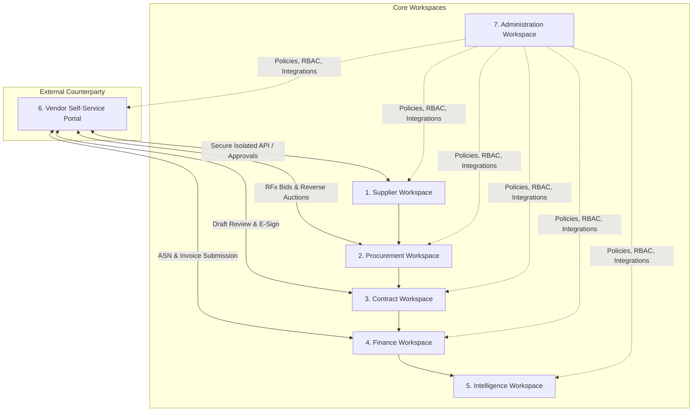
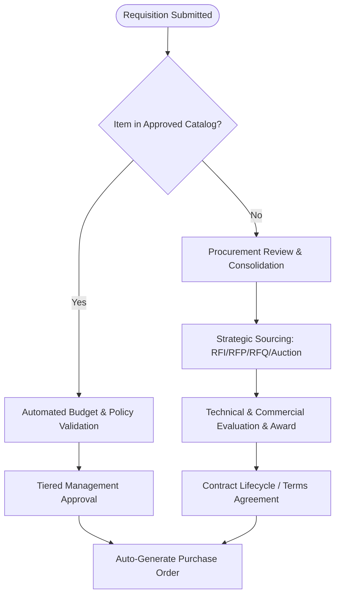
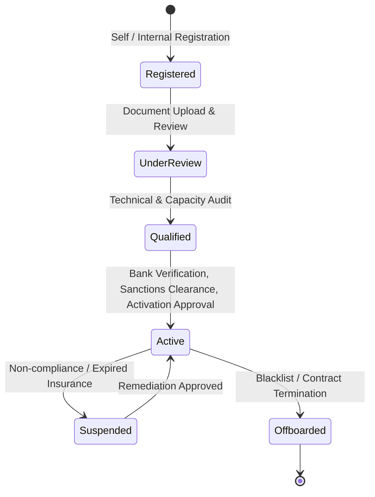
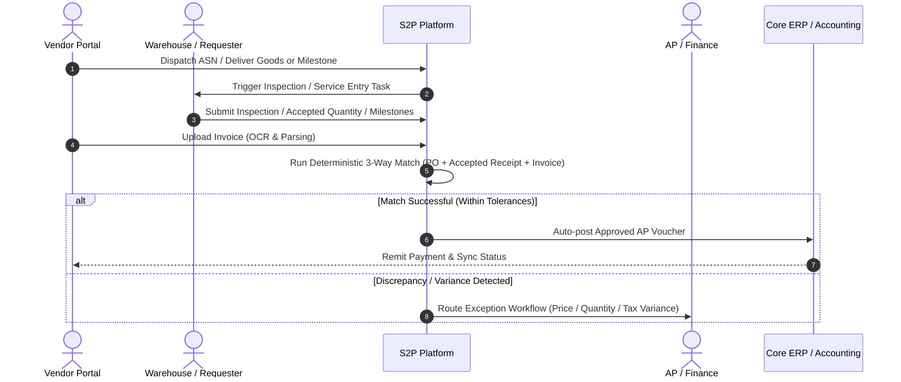
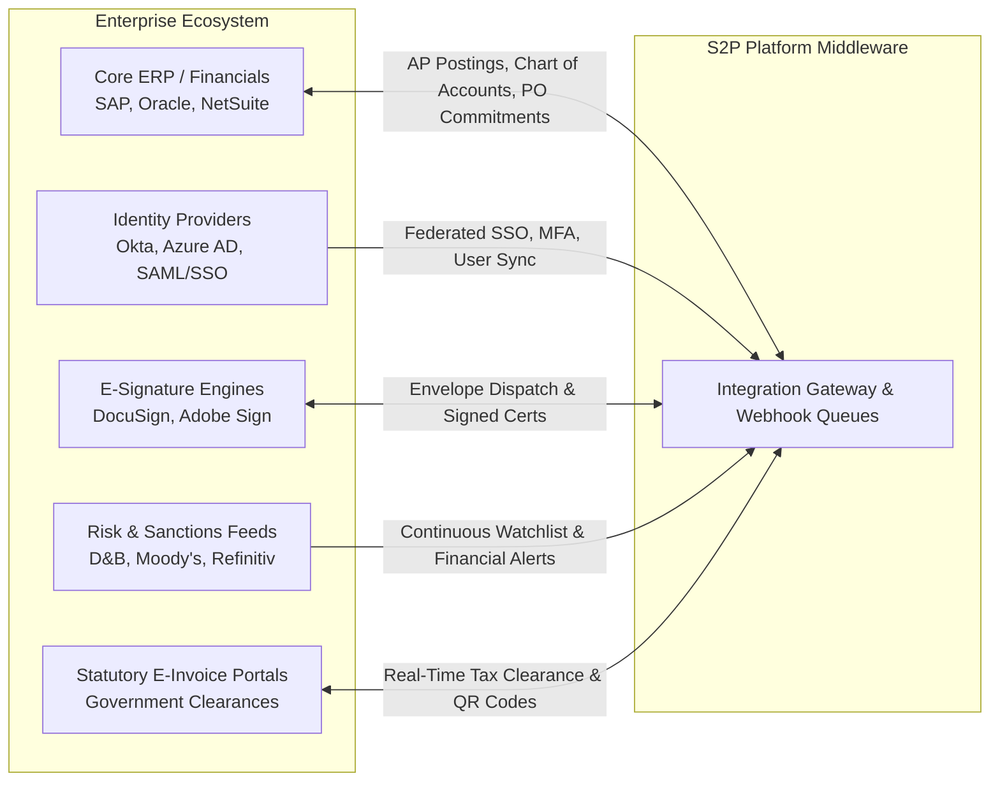
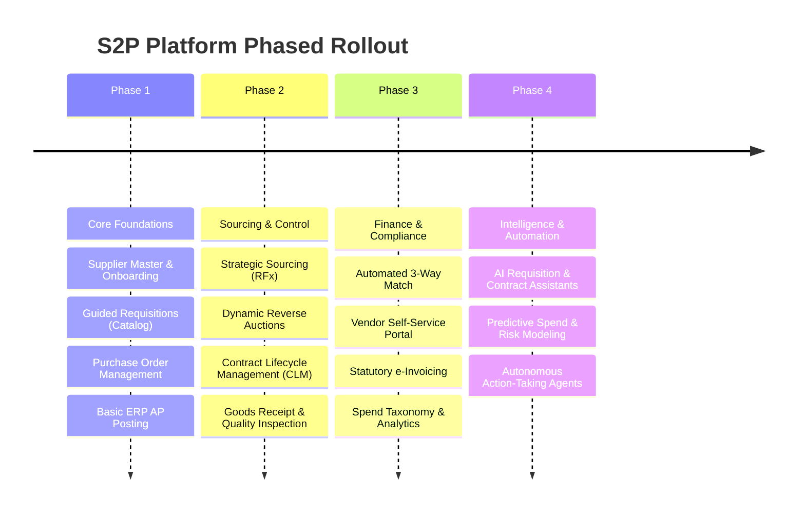

# Enterprise Source-to-Pay (S2P) & Spend Management Platform

> **System Specification & Implementation Blueprint**  
> *Derived from functional architecture defined in `demo project.docx`*

---

## 📌 Executive Overview

This repository specifies the architecture, functional requirements, data relationships, and governance controls for an end-to-end **Enterprise Source-to-Pay (S2P) and Supplier Relationship Management (SRM)** platform. 

The system unifies the entire procurement lifecycle into a single, cohesive, multi-entity environment—spanning initial supplier onboarding and qualification, strategic sourcing, contract lifecycle management, purchase requisitions and orders, receiving and service acceptance, automated 3-way invoice matching, accounts payable (AP) integration, and AI-powered spend analytics.


---

## 🏛️ Application Architecture & Workspaces

The platform is organized into **seven dedicated workspaces** tailored to specific business roles, ensuring strict segregation of duties, unified auditability, and dedicated user journeys:



### Workspace Directory

| Workspace | Target Modules & Capabilities | Primary Stakeholders |
| :--- | :--- | :--- |
| **1. Supplier Workspace** | Supplier master, self-onboarding, multi-tier relationships, qualification, risk scoring, ESG/sanctions due diligence, performance scorecards, offboarding. | Supplier Managers, Category Managers, Risk & Compliance Officers |
| **2. Procurement Workspace** | Guided requisitioning, catalog & punchout, strategic sourcing (RFx), dynamic auction engine, purchase order issuance, receipting, service entry sheets. | Requesters, Buyers, Sourcing Specialists, Receiving Clerks |
| **3. Contract Workspace (CLM)** | Contract intake, clause library, template-driven drafting, collaborative redlining, workflow approvals, electronic signatures, obligations & renewal pipelines. | Legal Counsel, Procurement Officers, Contract Managers |
| **4. Finance Workspace** | Invoice intake & OCR extraction, tolerance engines, deterministic 3-way matching, discrepancy workflows, ERP AP posting, payment status tracking. | Accounts Payable, Finance Managers, Tax Auditors |
| **5. Intelligence Workspace** | Spend taxonomy classification, category drill-downs, off-contract leakage, savings pipelines, demand forecasting, AI Copilots. | CPO, CFO, Spend Analysts, Procurement Executives |
| **6. Vendor Portal** | Independent external portal: registration, qualification submissions, RFx/bidding, PO confirmation, ASN dispatch, invoice uploading, disputes. | External Vendors, Suppliers, Service Providers |
| **7. Administration** | Multi-entity org hierarchy, role-based access control (RBAC), approval matrix, policy engine, audit logs, document rules, integration middleware. | System Admins, Security Officers, Compliance Auditors |

---

## 🔄 Core Business Workflows

### 1. Two-Track Requisition to Purchase Order Flow
The platform supports dual execution paths depending on requisition classification:
1. **Catalog Purchasing Track**: Requester selects pre-negotiated catalog items $\to$ Automated budget & policy check $\to$ Accelerated approval $\to$ Instant Purchase Order generation.
2. **Non-Standard Sourcing Track**: Requester submits free-text/SOW requirement $\to$ Procurement intake & consolidation $\to$ Strategic Sourcing (RFx / Reverse Auction) $\to$ Contract Execution $\to$ Approved Purchase Order.



### 2. Supplier Lifecycle Governance: Separation of Stages
> [!IMPORTANT]
> **Core System Control**: Supplier **Onboarding**, **Qualification**, and **Activation** are strictly isolated lifecycle gates. A registered or qualified vendor is **not** eligible for spend or payment until full due diligence, bank verification, and activation approvals are finalized.



### 3. Goods & Service Acceptance to 3-Way Invoice Match
> [!NOTE]
> Three-way matching is strictly evaluated against **accepted** product quantities or **approved** Service Entry Sheets (SES), rather than simple physical dock deliveries.



---

## 📦 Comprehensive Module Specifications

### Module 1: Supplier Management & SRM
* **Purpose**: Maintain an authoritative supplier master from initial registration through qualification, performance scorecards, and offboarding.
* **Key Feature Areas**:
  * **Supplier Registration**: Self-registration forms, internal sponsor onboarding, secure invitation links, tailored questionnaires (goods, services, consultants, international vendors).
  * **Authoritative Supplier Master**: Unified record shared across sourcing, CLM, POs, invoicing, and analytics (legal name, codes, addresses, tax IDs, banking terms).
  * **Multi-Entity Relationships**: Model parent corporations, subsidiaries, regional operating units, and localized branches across multiple buying legal entities.
  * **Document Lifecycle & Verification**: Collection of tax forms (W-8/W-9), bank letters, certifications, ISO standards, and insurance certificates with automated expiration tracking and status tracking (`Uploaded`, `Reviewed`, `Verified`, `Rejected`, `Expired`).
  * **Risk & Due Diligence**: Automated sanctions & watchlist screening (PEP/OFAC), ownership declarations, conflict-of-interest declarations, financial health feeds, operational dependency, and weighted scoring models.
  * **Segmentation & Scorecards**: Categorization into *Strategic*, *Preferred*, *Approved*, *Conditional*, or *Blocked*; quantitative scorecards calculated from transactional OTD (on-time delivery), rejection rates, SLA compliance, and responsiveness.
  * **Change Management & Offboarding**: Two-party verification for supplier banking adjustments; structured offboarding checks verifying zero open POs, receipts, or credit disputes.

### Module 2: Purchase Requisition Management (PR)
* **Purpose**: Capture organizational business demand and validate policy, budget availability, and approvals prior to committing company spend.
* **Key Feature Areas**:
  * **Flexible Requisition Types**: Goods, milestone services, software subscriptions, Capex, Opex, and emergency requisitions.
  * **Dual Procurement Channels**: Guided approved catalog buying (with unit contracts) vs. non-catalog requests (requiring strong commercial justification and sourcing review).
  * **Line-Item Granularity**: Multiple line items, split accounting allocations (by cost center, project, business unit, GL code), multiple ship-to addresses, and required delivery schedules.
  * **Pre-Commitment Budget Checking**: Real-time reservation against budgets at approval, automated release on rejection/cancellation, and strict policy boundary validation.
  * **Smart Approval Workflows**: Parallel and sequential routing based on net value, category, department, legal entity, and risk metrics; out-of-office delegation with audit trails.
  * **Downstream Conversion Engine**: Splitting or consolidating requisitions to feed RFx sourcing events, contract requests, or direct PO creation.

### Module 3: Strategic Sourcing & RFx Management
* **Purpose**: Structure competitive supplier events, objectively score technical and commercial responses, and document legally defensible award justifications.
* **Key Feature Areas**:
  * **RFx Event Engine**: Standardized authoring for RFI (Information), RFP (Proposals), RFQ (Quotes), and Expression of Interest (EOI).
  * **AI-Assisted Event Authoring**: Drafting category-specific requirements, evaluation weighting criteria, and structured supplier questionnaires.
  * **Sealed-Bid Integrity & Confidentiality**: Strict role-based isolation of commercial vs. technical evaluation teams; sealed bidding until formal event closing.
  * **Multi-Dimensional Evaluation**: Weighted scoring models combining technical capability, financial viability, compliance risk, and Total Cost of Ownership (TCO).
  * **Bid Normalization & Scenarios**: Currency conversions, freight/duty equalization, unit standardizations, and side-by-side scenario modeling (single award, multi-vendor splits, capacity allocations).
  * **Savings Tracking**: Clean distinction between baseline cost, negotiated savings, avoided costs, and realized contract savings.

### Module 4: Dynamic Auction Engine
* **Purpose**: Execute high-integrity, real-time competitive bidding events for procurement (reverse auctions) and asset disposal (forward auctions).
* **Key Feature Areas**:
  * **Authoritative Server Clock**: Server-authoritative timestamping, eliminating client latency exploits during rapid-fire bidding.
  * **Configurable Auction Rules**: Reserve prices, dynamic lot management, minimum bid increments, rank-only display, or price-visible competition.
  * **Anti-Sniping Controls**: Automatic event extensions (overtime) triggered by late bids within closing windows to ensure fair competition.
  * **Bid Protection**: Input validation preventing duplicate clicks or accidental irrational bidding errors.
  * **Full Audit Logging**: Second-by-second participant telemetry, bid history, pause/resume audit records, and savings calculations.

### Module 5: Vendor Self-Service Portal
* **Purpose**: Provide suppliers with a modern, secure portal to collaborate, participate in bids, acknowledge commitments, and trace payments without granting access to internal procurement systems.
* **Key Feature Areas**:
  * **Strict Data Isolation**: Multi-tenant supplier boundary preventing cross-vendor data exposure.
  * **Collaborative Capabilities**: RFx bidding, live auction consoles, purchase order acceptance/rejection, advance shipment notices (ASNs), and contract redlining.
  * **Self-Service Invoicing & Payment Tracker**: Direct invoice upload with pre-validation checks (duplicate invoice checks, PO reference validation) and real-time ERP payment status sync (`Approved`, `Scheduled`, `Paid`, `Disputed`).

### Module 6: Contract Lifecycle Management (CLM)
* **Purpose**: Govern enterprise agreements from contract intake and clause assembly through negotiation, execution, proactive obligation tracking, and renewal.
* **Key Feature Areas**:
  * **Contract Repository & Taxonomy**: Comprehensive support for NDAs, Master Services Agreements (MSAs), Statements of Work (SOWs), Purchase Agreements, Software Licenses, and Leases, with parent-child hierarchy modeling.
  * **Clause Library & Fallback Playbooks**: Centrally governed clause repository with mandatory legal terms, pre-approved fallback positions, and automated deviation detection.
  * **Collaborative Redlining & Versioning**: Version-controlled markup, tracked changes, counterparty redline uploads, and clause-level comparison.
  * **AI Document Extraction**: Ingest third-party contracts to extract obligations, expiry dates, payment milestones, governing law, and liabilities with source attribution.
  * **E-Signature Workflows**: Seamless integration with enterprise digital signature providers (DocuSign, Adobe Sign) with structured signing orders and tamper-proof audit trails.
  * **Obligation & Renewal Governance**: Granular owner assignments for contract deliverables, service credits, and automated notice-period alerts (alerting prior to notice deadlines, not merely on expiration).

### Module 7: Purchase Order Management (PO)
* **Purpose**: Convert approved procurement requirements into legally binding purchase commitments with suppliers.
* **Key Feature Areas**:
  * **Order Varieties**: Standard orders, milestone-driven service orders, blanket purchase orders (BPOs) with spending caps, and recurring releases.
  * **Contract & Rate Card Enforcement**: Automated validation ensuring line-item unit prices strictly honor active contract pricing schedules.
  * **Supplier Lifecycle Actions**: Electronic dispatch, automated PDF generation, supplier acknowledgement, change-order revisioning, and partial fulfillment tracking.
  * **Tolerances & Automated Closure**: System tolerance limits on delivery variance; automated encumbrance release upon complete invoicing or formal short-closing.

### Module 8: Goods Receipt, Quality & Service Acceptance
* **Purpose**: Provide auditable proof of physical delivery or service milestone acceptance prior to authorizing payment releases.
* **Key Feature Areas**:
  * **Receipt Processing**: PO-based warehouse receiving, serial number and batch/lot logging, packing slip attachments, and partial receipt handling.
  * **Quality Inspection & Quarantine**: Quality sampling, pass/fail grading, rejection workflows, and Return Material Authorization (RMA) coordination.
  * **Service Entry Sheets (SES)**: Milestone deliverables, consulting timesheet submissions, and formal business stakeholder acceptance sign-offs.
  * **Audit Rigor**: Reversal controls and correction logging preventing unapproved retroactive adjustments to completed receipts.

### Module 9: Invoice Processing, e-Invoicing & Accounts Payable
* **Purpose**: Intake invoices, perform automated OCR extraction, enforce 3-way matching rules, and dispatch approved liabilities to the accounting ERP.
* **Key Feature Areas**:
  * **Multi-Channel Intake & OCR**: Ingestion via vendor portal, dedicated email parsing, bulk upload, and automated e-invoicing APIs.
  * **Fraud & Duplicate Prevention**: Exact and heuristic duplicate detection (vendor ID, invoice number, amount, date thresholds, OCR document hash).
  * **Automated 3-Way Matching Engine**: Line-level matching between PO lines, accepted receipt/SES quantities, and invoice line items within configurable variance tolerances.
  * **Discrepancy Resolution**: Automated exception routing to procurement, warehouse, or finance for variance approvals.
  * **Statutory Compliance**: Native support for government e-invoicing protocols, tax-code mapping, and statutory withholding rules.
  * **ERP AP Posting**: Controlled posting of approved vouchers into SAP, Oracle, NetSuite, or Dynamics with retry queues and posting reconciliation.

### Module 10: Spend Analytics & Savings Management
* **Purpose**: Transform multi-source purchasing, invoice, contract, and accounting records into actionable intelligence, category strategies, and defensible savings reporting.
* **Key Feature Areas**:
  * **Unified Data Cleansing**: Ingestion and normalization of spend data across disparate ERPs and purchasing entities.
  * **Multidimensional Analysis**: Spend categorization by UNSPSC/custom taxonomies, vendor concentration, category dependency, and geographic risk.
  * **Leakage & Compliance Detection**: Visibility into maverick (off-contract) spend, non-preferred vendors, split-PO purchasing anomalies, and price variance between departments.
  * **Savings Pipeline**: Structured lifecycle tracking of savings: *Identified* $\to$ *Validated* $\to$ *Negotiated* $\to$ *Contracted* $\to$ *Realized*.

### Module 11: Document & Knowledge Management
* **Purpose**: Serve as the secure, searchable document repository underlying all system transactions.
* **Key Feature Areas**:
  * **Centralized Metadata Architecture**: Mandatory metadata tagging (document type, owner, legal entity, security level, expiration date).
  * **Intelligent Document Processing**: OCR scanning, semantic text indexing, full-text search, and automated expiration monitoring for compliance certificates.
  * **Security & Retention**: Antivirus/malware scanning on upload, cryptographic hashing, and automated retention/legal-hold compliance.

### Module 12: Workflow, Compliance & Administration
* **Purpose**: Provide enterprise configuration tools enabling organization-specific tuning without custom code development.
* **Key Feature Areas**:
  * **Enterprise Modeling**: Multi-entity corporate hierarchies, currencies, exchange rate feeds, tax jurisdictions, and operational locations.
  * **Granular RBAC & SoD**: Role-based access enforcement on every API endpoint; built-in Segregation of Duties (e.g., requisitioner cannot approve; bank details updater cannot approve AP payments).
  * **Visual Workflow Designer**: Drag-and-drop approval matrix builder supporting conditions, parallel approvals, step thresholds, and automated escalations.
  * **Immutable Audit Ledger**: Tamper-proof logging recording actor, timestamp, IP, action, before/after values, and approval decisions.

### Module 13: AI Assistants, Autonomous Agents & Governance
* **Purpose**: Augment user productivity across modules while maintaining strict policy guardrails, evidence citation, and human-in-the-loop validation.
* **Key Capabilities**:

| Assistant / Agent | Workspace | Core Capability | Safety & Governance Control |
| :--- | :--- | :--- | :--- |
| **Procurement Assistant** | Procurement | Answers policy queries, locates records, summarizes approvals. | Strictly grounded in approved company policies and user access levels. |
| **Supplier Assistant** | Supplier | Synthesizes onboarding documentation, identifies compliance gaps, explains risk score drivers. | Must cite verifiable document evidence; clearly separates external data from internal ratings. |
| **Requisition Assistant** | Procurement | Auto-drafts item specifications, identifies missing budget codes, suggests preferred vendors. | Requires explicit human requester verification prior to submission. |
| **Sourcing Assistant** | Procurement | Generates RFx questionnaires, normalizes complex vendor bids, drafts negotiation strategies. | Displays explicit calculation criteria and mathematical assumptions. |
| **Contract Assistant** | Contract | Extracts clause deviations, summarizes indemnities, tracks obligation milestones. | Highlights exact contract paragraph citations; routes deviations to legal counsel. |
| **Invoice Assistant** | Finance | Recommends line matches, explains tax discrepancies, suggests dispute steps. | Strictly deterministic matching logic for financial approval—never purely generative. |
| **Action-Taking Agents** | System-wide | Assembles draft transactions, queues reminders, flags compliance risks. | Enforces rigid approval gates, explicit financial limits, and reversible actions. |

---

## 🛡️ Critical System Controls & Implementation Guardrails

```
                                SYSTEM GUARDRAILS
 ┌─────────────────────────────────────────────────────────────────────────────┐
 │ 1. DATA SAFETY & PROMPT INJECTION RESISTANCE                                │
 │    Uploaded supplier documents (PDFs, invoices, RFx proposals) are treated  │
 │    strictly as untrusted evidentiary data—NEVER as execution instructions.  │
 ├─────────────────────────────────────────────────────────────────────────────┤
 │ 2. SEGREGATION OF DUTIES (SoD)                                              │
 │    The user who updates supplier bank accounts CANNOT approve disbursements.│
 │    The user who raises a PR CANNOT approve their own spend request.         │
 ├─────────────────────────────────────────────────────────────────────────────┤
 │ 3. THREE DISTINCT AP CONTROL POINTS                                         │
 │    [Invoice Approval]  ───>  [Accounting ERP Posting]  ───>  [Disbursement]│
 │    Each stage requires independent validation and distinct audit trails.    │
 ├─────────────────────────────────────────────────────────────────────────────┤
 │ 4. LINE-LEVEL DATA TRACEABILITY                                             │
 │    Line-item linkage is preserved across PR ──> RFx ──> PO ──> SES/GRN ──>  │
 │    Invoice lines to guarantee accurate partial delivery & billing.          │
 └─────────────────────────────────────────────────────────────────────────────┘
```

---

## 🔌 Integration Architecture

The platform is designed to sit at the center of the enterprise technology stack, interfacing via secure REST/GraphQL APIs and asynchronous event queues:



---

## 🚀 Phased Implementation Roadmap

To ensure low risk and fast time-to-value, follow the phased rollout methodology:



---

## 📄 Source Document Reference

This document synthesizes and formats all specifications from [`demo project.docx`](file:///c:/Users/hp/OneDrive/Desktop/demo-project/demo%20project.docx).
All functional modules, data tables, structural workspaces, and implementation guardrails are compliant with the master architecture.

